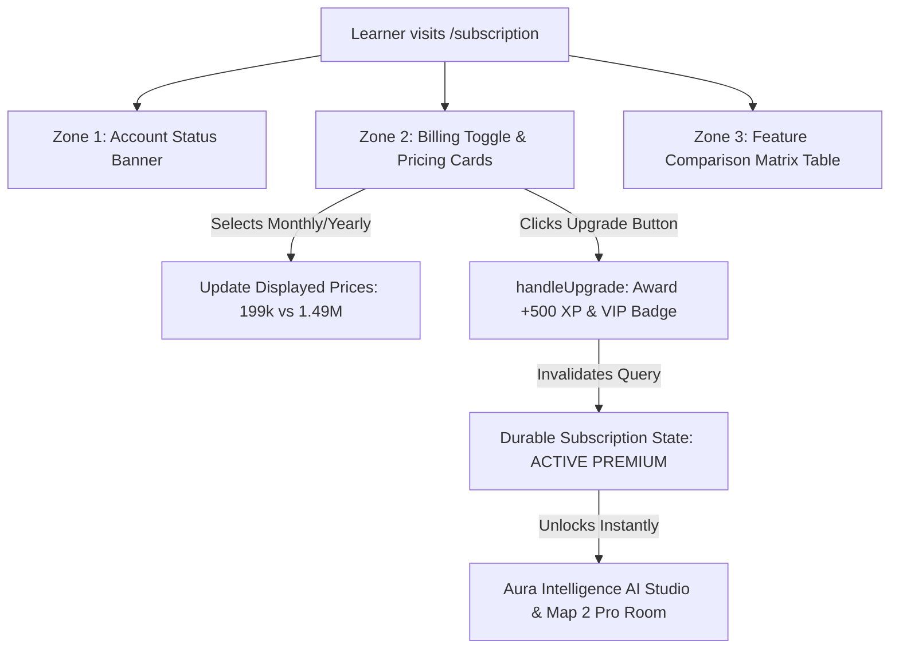

# Implementation Plan: FEAT-085 Option A (Commercial Pricing & Feature Comparison Matrix)

**Feature Code**: `FEAT-085-A`  
**Created**: 2026-10-23  
**Status**: APPROVED  
**Owners**: Antigravity Pair Programmer & Codex Architecture  
**Dependencies**: FEAT-071 (Auth), FEAT-072 (Dashboard), FEAT-084 (AI Access Control), FEAT-085 (Subscription Center)  

---

## 1. Executive Summary & Goals

This plan executes **Phương án A**: Cập nhật ngay bảng giá 2 gói (Standard: 0đ & Premium: 199.000đ/tháng, 1.490.000đ/năm) kèm bảng so sánh tính năng hoàn chỉnh lên giao diện `/subscription`.

Key objectives:
1. **Interactive Billing Cycle Toggle**: Allow switching between "Theo Tháng (199.000đ/tháng)" and "Theo Năm (1.490.000đ/năm - Tiết kiệm 38% 🔥)".
2. **Dual-Tier Pricing Cards**: High-contrast, FinTech-grade cards for Standard (0đ) and Premium (featured gradient, VIP perks).
3. **8-Row Feature Comparison Table**: Full transparency on virtual capital, Map 1/2 limits, AI Studio access, trade analysis, Academy stages, and XP rewards.
4. **Zero Regressions & Server Authority**: Preserve 100% test compatibility with `SubscriptionPage.test.tsx` and maintain all constitution invariants.

---

## 2. Architecture & Component Blueprint

---

## 3. Technical Deliverables

### Deliverable 1: Billing Cycle Toggle & Pricing Data
- In `apps/web/src/features/subscription/pages/SubscriptionPage.tsx`:
  - Add `billingCycle` state: `"monthly" | "yearly"`, default `"yearly"`.
  - Render interactive pill toggle button group with savings badge `Tiết kiệm 38% 🔥`.
  - Dynamically format prices:
    - Monthly: `199.000 ₫ / tháng`
    - Yearly: `1.490.000 ₫ / năm` (kèm chú thích `~124.000 ₫ / tháng`).

### Deliverable 2: 2-Column Pricing Cards Grid
- In `SubscriptionPage.tsx`:
  - **Standard Card (Gói Tiêu Chuẩn)**:
    - Tagline: "Bắt đầu hành trình đầu tư thực chiến không rủi ro tài chính".
    - Price: `0 ₫ / Trọn đời`.
    - Key bullet points: Vốn ảo 100M VND, Không giới hạn Map 1, 3 phiên Map 2/tháng, 10 truy vấn AI Coach/ngày, Chặng 1 & 2 Academy.
    - Status button: `Đang Kích Hoạt` (nếu đang ở Free) hoặc `Gói Mặc Định`.
  - **Premium VIP Card (Gói Cao Cấp)**:
    - Badge: `⭐ PHỔ BIẾN NHẤT & KHUYÊN DÙNG`.
    - Tagline: "Làm chủ tư duy đầu tư tổ chức và đồng hành cùng AI Coach 24/7".
    - Price: Displayed based on toggle.
    - Highlight: `✨ Tặng ngay +500 XP & Huy hiệu VIP Patron`.
    - Key bullet points: Tùy biến vốn lên tới 1 tỷ VND, Không giới hạn Map 1 & Map 2, Không giới hạn Aura AI Studio 24/7, Mở khóa toàn bộ Academy (Chặng 3 phái sinh), Xuất báo cáo hiệu suất.
    - Action button: `data-testid="subscription-upgrade-button"` with label `Nâng Cấp Gói Premium VIP`.

### Deliverable 3: Feature Comparison Matrix Table
- Structure an 8-row table comparing Standard vs Premium:
  1. Vốn Ảo Khởi Điểm (100M VND vs Lên tới 1 Tỷ VND)
  2. Đấu Trường FOMO - Map 1 (Không giới hạn vs Không giới hạn)
  3. Đấu Trường Pro Room - Map 2 (3 phiên / tháng vs Không giới hạn)
  4. Trợ Lý AI Aura Intelligence (10 câu hỏi / ngày vs Không giới hạn 24/7)
  5. Phân Tích Kỷ Luật & Tâm Lý Lệnh (Đánh giá chung vs Bóc tách chuyên sâu từng chu kỳ)
  6. Học Viện Aura Academy (Chặng 1 & 2 vs 100% Khóa học & Phái sinh)
  7. Đặc Quyền Bảng Xếp Hạng (Xếp hạng chuẩn vs Huy hiệu VIP Patron vàng)
  8. Quà Tặng Điểm Thưởng XP (200 XP mặc định vs +500 XP gia nhập)

### Deliverable 4: Design Tokens & CSS Styling
- In `apps/web/src/index.css`:
  - Responsive pricing grid layout (`.subscription-pricing-grid`).
  - High-converting card styles (`.pricing-card`, `.pricing-card-featured`).
  - Sleek FinTech comparison table (`.subscription-comparison-table`).
  - Mobile-friendly responsive breakpoints.

### Deliverable 5: Server Plan Catalog Synchronization
- In `apps/api/src/modules/subscription/plan-catalog.ts`:
  - Ensure public display copy in `SERVER_PLAN_CATALOG` accurately conveys:
    - `FREE`: "Gói Tiêu Chuẩn — Trải nghiệm miễn phí nền tảng học tập & đấu trường giả lập."
    - `PREMIUM`: "Gói Cao Cấp (VIP) — Quyền truy cập không giới hạn Aura AI Studio & đấu trường tổ chức."

---

## 4. Constitution & Invariant Checks

| Nguyên tắc | Đánh giá | Giải pháp đảm bảo |
| :--- | :--- | :--- |
| **I. Server Authority** | TUÂN THỦ | Không tính toán tài sản hoặc ngày hết hạn ở client; chỉ gửi yêu cầu nâng cấp/hủy lên server hoặc kích hoạt demo command environment đã được phê duyệt. |
| **II. Persistence Boundary** | TUÂN THỦ | Không sử dụng mutable filesystem storage. |
| **III. AI Access Governance** | TUÂN THỦ | Gói Premium kích hoạt quyền `PREMIUM_ACCESS` cho AI Studio; Gói Standard áp dụng rate limit token budget. |
| **IV. Canonical Route Governance** | TUÂN THỦ | Giữ nguyên route `/subscription`, đảm bảo đầy đủ loading state, error boundary và accessibility. |
| **V. Test Rigor** | TUÂN THỦ | Giữ nguyên tất cả `data-testid` hiện tại; đảm bảo `SubscriptionPage.test.tsx` pass 100%. |

---

## 5. Implementation Tasks

- [ ] Task 1: Thêm state `billingCycle` và khai báo dữ liệu giá 199k/tháng & 1.49tr/năm.
- [ ] Task 2: Xây dựng Component Bảng Giá 2 Thẻ (Standard & Premium Card).
- [ ] Task 3: Xây dựng Component Bảng So Sánh Chi Tiết Quyền Lợi (Comparison Table).
- [ ] Task 4: Bổ sung CSS classes trong `index.css` với design tokens.
- [ ] Task 5: Cập nhật server plan catalog trong `plan-catalog.ts`.
- [ ] Task 6: Chạy test suite `SubscriptionPage.test.tsx`, `npm run typecheck`, và `npm run build`.
