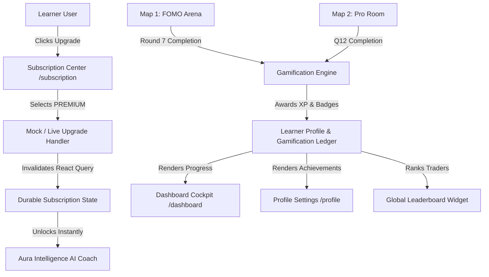

# Implementation Plan: FEAT-085 Commercial Subscription Center, Gamification Loop & Simulation Scoreboard

**Feature Code**: `FEAT-085`  
**Created**: 2026-10-13  
**Status**: APPROVED  
**Owners**: Antigravity Pair Programmer & Codex Architecture  

---

## 1. Architecture & Component Blueprint

---

## 2. Technical Deliverables

### Deliverable 1: Commercial Subscription Activation
- **Route Mounting**: Replace `<PlannedRoutePlaceholder>` with `<SubscriptionRoutes />` in `AppShell.tsx`.
- **Registry Update**: Mark `CANONICAL_ROUTES.SUBSCRIPTION` in `route-registry.ts` as `AVAILABLE`.
- **Subscription Page Upgrade UX**: Enhance `SubscriptionPage.tsx` with an immediate "Nâng Cấp Gói Premium" demo action that persists an active `PREMIUM` subscription for the session and invalidates the query client, immediately unlocking the AI Coach.
- **E2E Test Alignment**: Update `tests/e2e/subscription-learner-journey.spec.tsx` to verify the live `SubscriptionPage` renders plans and handles upgrade interactions without errors.

### Deliverable 2: Gamification Ledger & Service (`gamification.service.ts`)
- Local & server persistence of:
  - User XP, level thresholds (Level 1..5).
  - Unlocked badges (`SURVIVOR`, `MACRO_TACTICIAN`, `MARKET_SCHOLAR`, `PREMIUM_VIP`).
  - Simulation Game Runs (Map 1 & Map 2 runs with NAV, Return %, FOMO Index, Alpha).
  - Seeded realistic Leaderboard with high-tier community participants.

### Deliverable 3: Simulation Map 1 & Map 2 Integration
- In Map 1 (`apps/web/src/features/simulation/map1/components/Map1DebriefModal.tsx`):
  - Add game completion handler to award XP (+150 XP) and conditionally unlock *Survivor Badge* if FOMO Index < 50% and portfolio remained positive.
- In Map 2 (`apps/web/src/features/simulation/map2/components/Map2DebriefModal.tsx`):
  - Add game completion handler to award XP (+200 XP) and conditionally unlock *Macro Tactician Badge* if Alpha > 0%.

### Deliverable 4: Gamification Cockpit & Leaderboard UI
- Component `GamificationCockpit.tsx`:
  - Visual Level Badge, Next Level progress meter, XP counter.
  - Interactive Badges Showcase (unlocked vs locked badges with tooltips).
  - High-score simulation summary card.
- Component `SimulationLeaderboard.tsx`:
  - Top 10 Simulated Traders list with avatar, map, return %, and badges.
- Integration in `/dashboard`, `/profile`, and `/simulation`.

### Deliverable 5: Design System & Styling
- Semantic token styling in `apps/web/src/index.css`:
  - Glassmorphic `.gamification-cockpit`, `.xp-progress-bar`, `.badge-item-unlocked`, `.badge-item-locked`, `.leaderboard-table`.
  - Contrast and typography following `tokens.css`.
