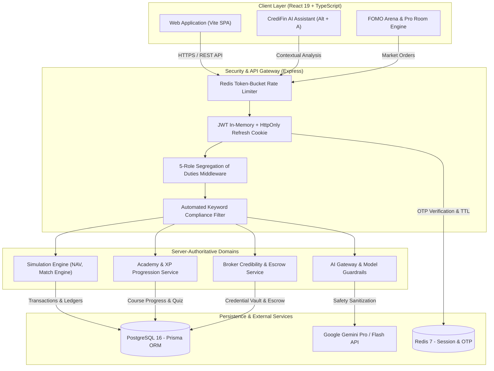

# Aura Capital — AI-Powered Financial Learning & Market Simulation Platform

<div align="center">


[](https://www.typescriptlang.org/)
[](https://nodejs.org/)
[](https://react.dev/)
[](https://vitejs.dev/)
[](https://www.prisma.io/)
[](https://www.postgresql.org/)
[](https://redis.io/)
[](https://www.docker.com/)
[](https://vitest.dev/)
[](LICENSE)

**Nền tảng Học viện & Đấu trường Giả lập Đầu tư Tài chính Chuẩn Định chế**  
_Môi trường rèn luyện tâm lý giao dịch, phân bổ tài sản vĩ mô và cố vấn AI — 100% không rủi ro tài chính thật._

[Tổng Quan](#-1-tổng-quan-nền-tảng-platform-overview) • [Trụ Cột Sản Phẩm](#-2-trụ-cột-năng-lực-cốt-lõi-core-pillars) • [Kiến Trúc Hệ Thống](#-3-kiến-trúc-kỹ-thuật--monorepo) • [Khởi Chạy Nhanh](#-4-khởi-chạy-nhanh--quickstart) • [Tiêu Chuẩn Kỹ Thuật](#-5-tiêu-chuẩn-kỹ-thuật--quality-gates) • [Triển Khai Vận Hành](#-6-triển-khai-sản-xuất-production-deployment) • [Miễn Trừ Trách Nhiệm](#-7-tuyên-bố-miễn-trừ-trách-nhiệm-academic-sandbox-disclaimer)

---

</div>

## 🌟 1. Tổng Quan Nền Tảng (Platform Overview)

**Aura Capital** là hệ sinh thái công nghệ giáo dục tài chính (EdTech & FinTech Simulation) tiên phong, được thiết kế nhằm thu hẹp khoảng cách giữa lý thuyết tài chính hàn lâm và thực chiến thị trường khốc liệt.

Khác với các ứng dụng giao dịch thử nghiệm thông thường chỉ cung cấp biểu đồ tĩnh, Aura Capital tái hiện toàn diện **áp lực tâm lý thị trường**, **biến động vĩ mô nhiều chu kỳ**, và **hành vi đám đông** thông qua hai đấu trường chuyên biệt:

- **FOMO Arena (Map 1)**: Rèn luyện khả năng quản trị tâm lý ngắn hạn trước bẫy FOMO/FUD, tin đồn room VIP và biến động giá dồn dập.
- **Macro Pro Room (Map 2)**: Thao lược phân bổ tài sản đa lớp (Cổ phiếu VN30, Trái phiếu, Tiền mặt) qua 12 quý vĩ mô đối mặt với lạm phát, suy thoái và chính sách tiền tệ.

Nền tảng được xây dựng trên triết lý **Server-Authoritative**, chuẩn mực bảo mật ngân hàng (Argon2id, AES-256 Vault, Redis Rate Limiting) cùng Cố vấn Trí tuệ Nhân tạo **Aura Intelligence (CrediFin AI Advisor)** đồng hành cùng nhà đầu tư 24/7.

> [!IMPORTANT]
> **Academic Sandbox Policy (Chính sách Đào tạo Giả lập)**:  
> Aura Capital là nền tảng học tập và nghiên cứu mô phỏng 100%. Nền tảng **KHÔNG PHẢI LÀ CÔNG TY CHỨNG KHOÁN (NON-BROKERAGE)**, không nhận tiền gửi, không giữ tiền thật, không cung cấp dịch vụ môi giới thực tế và không thực hiện bất kỳ lệnh giao dịch tài chính nào ra thị trường thật. Mọi tài sản, số dư và lệnh giao dịch trên hệ thống là tiền tệ giả lập phục vụ mục đích đào tạo.

---

## 🏛️ 2. Trụ Cột Năng Lực Cốt Lõi (Core Pillars)

```
┌────────────────────────────────────────────────────────────────────────────────────────────────────────┐
│ [AC Logo] Aura Capital │ Trang Chủ │ Tổng Quan │ Khóa Học │ Đấu Trường │ Broker Hub │ Danh Mục │ Cộng Đồng │ ✨ Upgrade │
└────────────────────────────────────────────────────────────────────────────────────────────────────────┘
```

### 🎓 1. Học Viện Tài Chính (Aura Academy)

- **Lộ trình phân tầng 3 cấp độ**: Từ nhập môn tài chính cá nhân, định giá cơ bản (P/E, P/B, DCF) tới các chiến lược phòng hộ phái sinh nâng cao (VN30F Hedging).
- **Interactive Micro-Learning**: Thẻ bài học ngắn gọn, bộ Flashcards tương tác 3D lật mở thuật ngữ nhanh, kèm hệ thống trắc nghiệm tình huống chấm điểm tự động.
- **Hệ thống Gamification**: Tích lũy điểm kinh nghiệm (XP), thăng hạng danh hiệu học viên và vinh danh huy hiệu thành tích số.

### ⚡ 2. Đấu Trường Giao Dịch Giả Lập (Aura Arena)

- **Map 1 — FOMO Arena (7 Vòng / 45s)**:
  - Tái hiện áp lực tâm lý trong ngày giao dịch: Nến giật micro-ticking 1.5s, luồng tin đồn "VIP Hype Room", và bẫy tâm lý đám đông.
  - Đo lường và phân tích **FOMO Index (0 – 100)**: Bóc tách tốc độ bấm lệnh, hành vi đu đỉnh, gồng lỗ và sử dụng đòn bẩy quá mức.
- **Map 2 — Macro Pro Room (12 Quý Vĩ Mô)**:
  - _Điều kiện mở khóa_: Bắt buộc hoàn thành và sống sót qua Map 1.
  - Phân bổ tài sản chiến lược đa lớp: Cổ phiếu tăng trưởng, Cổ tức giá trị, Trái phiếu định chế và Tiền mặt.
  - Mô phỏng chu kỳ kinh tế: Tăng/giảm lãi suất điều hành, khủng hoảng thanh khoản, cú sốc chuỗi cung ứng.
  - Đánh giá theo chuẩn mực quỹ định chế: Đo lường CAGR, Sharpe Ratio, Max Drawdown (MDD) và cấp Chứng chỉ Chu kỳ Hoàn thành.

### 🤖 3. Cố Vấn Trí Tuệ Nhân Tạo (Aura Intelligence — CrediFin AI Advisor)

- **Hỗ trợ 24/7 tức thì**: Kích hoạt nhanh thông qua phím tắt `Alt + A` hoặc biểu tượng cố vấn cố định.
- **Model-Based Safety Guardrails**: Bộ lọc an toàn AI ngăn chặn prompt injection, giữ phạm vi hội thoại nghiêm ngặt trong phân tích tài chính học thuật.
- **Phản biện luận điểm đầu tư**: Đặt câu hỏi chất vấn trước khi học viên giải ngân, cảnh báo rủi ro tập trung ngành và đề xuất tỷ lệ phòng hộ phù hợp.

### 🛡️ 4. Sàn Chuyên Gia Xác Thực (Broker Credibility Hub — "Chống Lùa Gà")

- **Quy trình thẩm định 2 tầng nghiêm ngặt (2-Tier Gatekeeping)**:
  - _Cổng 1 (Thẩm định Định danh)_: Yêu cầu bắt buộc nộp Số chứng chỉ hành nghề UBCKNN hợp lệ và eKYC CCCD. Chỉ có `SYSTEM_ADMIN` mới có thẩm quyền phê duyệt cấp tích xanh.
  - _Cổng 2 (Kiểm duyệt Nội dung)_: Quét tự động từ khóa cam kết lợi nhuận bất hợp pháp ("cam kết lãi 100%", "ủy thác đầu tư", "chắc ăn"). `MODERATOR` giám sát và gỡ bài vi phạm.
- **Room Độc Quyền & Escrow Doanh Thu**: Chuyên gia xuất bản bài phân tích, tổ chức kịch bản thực chiến riêng cho hội viên. Hệ thống Smart Escrow tự động phân chia doanh thu phí vào phòng minh bạch.

### 📊 5. Phân Tích Danh Mục & Hạch Toán NAV (Portfolio Analytics)

- **Server-Authoritative NAV Engine**: Định giá tài sản ròng liên tục theo thị giá giả lập, loại bỏ hoàn toàn gian lận client-side.
- **Phân tích chiều sâu**: Biểu đồ cơ cấu nhóm ngành (Ngân hàng, Bất động sản, Thép, Công nghệ...), nhật ký giao dịch minh bạch, đo lường tỷ suất sinh lời thực tế.

### 🌐 6. Diễn Đàn Đầu Tư Kỷ Luật (Community Trading Hub)

- **Kiến trúc 3 cột chuẩn mực**: Bộ lọc luồng thảo luận, cập nhật chỉ số VN-INDEX/VN30 trực tiếp, trình soạn thảo bài viết gắn mã cổ phiếu (`$FPT`, `$MWG`...), bảng xếp hạng Top Nhà Đầu Tư kỷ luật và lịch Masterclass hàng tuần.

---

## 🏗️ 3. Kiến Trúc Kỹ Thuật & Monorepo

Dự án được tổ chức theo kiến trúc **Modular Monolith** sử dụng **npm workspaces**, phân tách ranh giới rõ ràng giữa Giao diện, Nghiệp vụ máy chủ và Hợp đồng dữ liệu dùng chung.

```text
aura-capital/
├── apps/
│   ├── api/                      # Backend API (Node.js 22 + Express + TypeScript)
│   │   ├── prisma/               # Prisma Schema & PostgreSQL Migrations
│   │   ├── src/
│   │   │   ├── infrastructure/   # Database, Redis, Logger, Config & Security Vault
│   │   │   ├── middleware/       # RBAC, Rate-Limiting, Error Handling, Request Log
│   │   │   ├── modules/          # Auth, Academy, Simulation, Portfolio, Community,
│   │   │   │                     # Broker Hub, Subscription, AI Engine, Admin
│   │   │   └── server.ts         # Express Application Bootstrapper
│   │   └── tests/                # Unit, DB Constraints, Security & Integration Tests
│   └── web/                      # Frontend SPA (React 19 + Vite 6 + TypeScript)
│       ├── src/
│       │   ├── components/       # Shared UI Components & Role Gateways
│       │   ├── contexts/         # AuthContext, NotificationContext
│       │   ├── features/         # Feature Views (Academy, Simulation, Broker, etc.)
│       │   ├── hooks/            # Custom Hooks (useAuth, useMarketWebSocket, etc.)
│       │   └── pages/            # Canonical Page Routes
│       └── tests/                # Component & User Journey Tests
├── packages/
│   └── shared/                   # Source of Truth dùng chung
│       └── src/
│           ├── constants/        # System Constants, Role Enums, Route Registry
│           ├── schemas/          # Zod Validation Schemas (Auth, Orders, Posts, AI)
│           └── types/            # TypeScript Domain DTOs & Error Envelopes
├── docs/                         # Hiến pháp dự án, ADRs, Guide triển khai VPS & Render
├── scripts/                      # Setup máy mới 1 chạm, sao lưu DB, mã hóa Vault
├── docker-compose.yml            # Docker local services (PostgreSQL 16, Redis 7)
├── docker-compose.prod.yml       # Production stack (API, Web, DB, Redis, Caddy SSL)
└── .specify/                     # Spec-Driven Development Artifacts & Constitution
```

### Sơ Đồ Luồng Dữ Liệu & Bảo Mật



---

## 👥 4. Phân Quyền 5 Tầng (Segregation of Duties — SoD)

Hệ thống tuân thủ nghiêm ngặt **Điều khoản IX trong Hiến pháp Aura Capital**, phân tách ranh giới kiểm soát rủi ro độc lập:

| Nghiệp Vụ / Chức Năng                             | GUEST | LEARNER |      BROKER      |  MODERATOR   |  SYSTEM_ADMIN   |
| :------------------------------------------------ | :---: | :-----: | :--------------: | :----------: | :-------------: |
| **Xem Landing Page, Catalog & Profile Broker**    |  ✅   |   ✅    |        ✅        |      ✅      |       ✅        |
| **Học Academy, Lật Flashcard, Làm Quiz nhận XP**  |  ❌   |   ✅    |        ✅        |      ✅      |       ✅        |
| **Biên tập / Xuất bản Khóa học chuẩn của Viện**   |  ❌   |   ❌    |        ❌        | ✅ _(Chính)_ |       ✅        |
| **Thi đấu FOMO Arena (Map 1) & Pro Room (Map 2)** |  ❌   |   ✅    |        ✅        |      ✅      |       ✅        |
| **Nộp hồ sơ cấp quyền Broker (UBCKNN + eKYC)**    |  ❌   |   ✅    |        ➖        |      ❌      |       ❌        |
| **Duyệt hồ sơ & Cấp Tích Xanh Broker**            |  ❌   |   ❌    |        ❌        |      ❌      | ✅ _(Duy nhất)_ |
| **Tạo Room riêng, Đăng bài & Thiết kế kịch bản**  |  ❌   |   ❌    | ✅ _(Room mình)_ |      ❌      |       ❌        |
| **Đăng bài Diễn đàn, Thả tim, Đính kèm $MÃ**      |  ❌   |   ✅    |        ✅        |      ✅      |       ✅        |
| **Xử lý vi phạm, Ẩn bài đăng, Mute tạm thời 24h** |  ❌   |   ❌    |        ❌        | ✅ _(Chính)_ |       ✅        |
| **Khóa / Mở khóa User, Đổi Role, Xem Audit Log**  |  ❌   |   ❌    |        ❌        |      ❌      | ✅ _(Duy nhất)_ |

---

## ⚡ 5. Khởi Chạy Nhanh (Quickstart & Local Setup)

### Yêu Cầu Tiên Quyết (Prerequisites)

- **Node.js**: `v20+` hoặc `v22+ LTS` (khuyến nghị `v22.x`)
- **npm**: `v10+`
- **Docker Desktop**: Cần thiết để chạy PostgreSQL 16 và Redis 7 local.

---

### Cách 1: Thiết Lập Tự Động 1-Chạm (Khuyến Nghị Cho Máy Mới)

Nếu bạn vừa clone repository về máy mới, chỉ cần chạy một lệnh duy nhất. Script sẽ tự động khôi phục cấu hình bảo mật từ kho mã hóa `.env.vault`, cài đặt thư viện, bật Docker và chạy database migrations:

```powershell
# Trên Windows PowerShell
.\scripts\setup-machine.ps1
```

```bash
# Trên Linux / macOS
chmod +x ./scripts/setup-machine.sh
./scripts/setup-machine.sh
```

> [!TIP]
> Nếu bạn có tệp bí mật mã hóa `.env.vault`, script sẽ yêu cầu nhập mật mã chủ (Master Password) để giải mã AES-256 an toàn. Nếu chưa có, script sẽ tự tạo `.env` chuẩn từ mẫu `.env.example`.

---

### Cách 2: Thiết Lập Thủ Công Từng Bước (Manual Step-by-Step)

#### Bước 1: Clone và Cài Đặt Phụ Thuộc

```bash
git clone https://github.com/Rekk-tech/Ura-capital.git
cd Ura-capital
npm install
```

#### Bước 2: Thiết Lập Biến Môi Trường

```bash
# Windows PowerShell
Copy-Item .env.example .env

# Linux / macOS
cp .env.example .env
```

_Lưu ý: Mở `.env` và đảm bảo `JWT_SECRET` có độ dài tối thiểu 32 ký tự. Hệ thống sẽ áp dụng Fail-Fast và từ chối khởi động nếu thiếu cấu hình bắt buộc._

#### Bước 3: Khởi Động Cơ Sở Dữ Liệu & Redis

```bash
docker compose up -d postgres redis
```

#### Bước 4: Chạy Migration & Seed Dữ Liệu Mẫu

```bash
# Sinh mã Prisma Client
npm run prisma:generate --workspace=@aura/api

# Áp dụng migration lên PostgreSQL
npm run prisma:migrate:deploy --workspace=@aura/api

# Nạp dữ liệu khởi tạo phát triển (Tài khoản mẫu, khóa học, dữ liệu thị trường)
npm run seed:dev
```

#### Bước 5: Chạy Máy Chủ Phát Triển (Full-Stack)

```bash
npm run dev
```

Hệ thống sẽ đồng thời khởi chạy:

- 🌐 **Web Client**: [http://localhost:5173](http://localhost:5173)
- 🔌 **API Server**: [http://localhost:3000](http://localhost:3000) (hoặc port cấu hình trong `.env`)
- 🩺 **Kiểm tra Healthcheck**: `curl http://localhost:3000/health`

---

## 🧪 6. Tiêu Chuẩn Kỹ Thuật & Quality Gates

Mọi thay đổi mã nguồn trước khi tích hợp vào nhánh chính (`main`) đều phải vượt qua toàn bộ các hàng rào kiểm định tự động:

```bash
# 1. Kiểm tra định dạng và quy tắc Linting
npm run lint

# 2. Kiểm tra tính toàn vẹn kiểu dữ liệu TypeScript (Strict Typecheck)
npm run typecheck

# 3. Chạy toàn bộ Unit & Integration Tests (Vitest)
npm run test

# 4. Kiểm thử ràng buộc cơ sở dữ liệu (PostgreSQL Transactional Isolation)
npm run test:db

# 5. Kiểm thử hàng rào phân quyền và bảo mật tài khoản (RBAC & Entitlement)
npm run test:security

# 6. Kiểm thử cơ chế Rate-Limit & Bộ nhớ đệm Redis
npm run test:redis

# 7. Kiểm tra hàng rào kiến trúc (Ngăn chặn vi phạm ghi trực tiếp filesystem)
npm run guard:boundary
npm run guard:persistence

# 8. Đóng gói ứng dụng toàn diện (Production Build)
npm run build
```

---

## 🚀 7. Triển Khai Sản Xuất (Production Deployment)

### 1. Triển Khai VPS Độc Lập Qua Docker Compose & Caddy (Khuyến Nghị)

Hệ thống hỗ trợ tệp triển khai toàn diện [docker-compose.prod.yml](file:///d:/project/ura-capital/docker-compose.prod.yml) tích hợp sẵn **Caddy Web Server** tự động cấp phát chứng chỉ SSL/TLS Let's Encrypt:

```bash
# Khởi động toàn bộ cụm dịch vụ Production (Web, API, Postgres, Redis, Caddy)
docker compose -f docker-compose.prod.yml up -d --build
```

> Chi tiết hướng dẫn cấu hình máy chủ Linux, tường lửa UFW và tối ưu hóa hiệu năng xem tại [docs/vps-deployment-guide.md](file:///d:/project/ura-capital/docs/vps-deployment-guide.md).

### 2. Triển Khai Đa Nền Tảng (Cloudflare Pages + Render / Container)

- **Frontend SPA**: Triển khai siêu tốc trên **Cloudflare Pages** (kết nối trực tiếp nhánh `main`, thư mục xuất bản `apps/web/dist`, Build Command: `npm run build:web`).
- **Backend API**: Triển khai trên **Render Web Service** hoặc VPS Container (Node.js runtime, tự động kết nối managed PostgreSQL và Upstash/Redis).

### 3. Cơ Chế Sao Lưu Định Kỳ & Bảo Mật Khôi Phục Thảm Họa (DRP)

- **Sao lưu cơ sở dữ liệu tự động**: Sử dụng [scripts/backup-db.sh](file:///d:/project/ura-capital/scripts/backup-db.sh) để nén và mã hóa bản dump PostgreSQL hàng ngày.
- **Bảo mật bí mật môi trường**: Sử dụng [scripts/export-secrets.ps1](file:///d:/project/ura-capital/scripts/export-secrets.ps1) đóng gói biến môi trường production thành `.env.vault` mã hóa AES-256 an toàn trước khi lưu trữ off-site.

---

## ⚖️ 8. Tuyên Bố Miễn Trừ Trách Nhiệm (Academic Sandbox Disclaimer)

> [!WARNING]
> **TUYÊN BỐ QUAN TRỌNG VỀ PHÁP LÝ VÀ BẢN CHẤT SẢN PHẨM**:
>
> 1. **Mục đích Giáo dục & Mô phỏng Thuần túy**: Nền tảng Aura Capital được phát triển độc quyền cho mục đích học tập, đào tạo kỹ năng phân tích và rèn luyện tâm lý đầu tư. Toàn bộ tiền tệ, cổ phiếu, lệnh giao dịch và chỉ số hiệu suất trên nền tảng là **HOÀN TOÀN GIẢ LẬP**.
> 2. **Chính sách Phi Môi giới (Non-Brokerage Policy)**: Aura Capital **KHÔNG PHẢI** là công ty chứng khoán, không đại diện cho bất kỳ sàn giao dịch chứng khoán nào, không tiếp nhận quản lý tài sản ủy thác và không cung cấp dịch vụ đặt lệnh chứng khoán ra thị trường thực tế.
> 3. **Không Phải Lời Khuyên Đầu Tư**: Mọi thông tin, phân tích, phản hồi từ Cố vấn AI CrediFin, nội dung thảo luận từ cộng đồng hoặc bài viết trong phòng Broker chỉ mang tính chất tham khảo học thuật, **tuyệt đối không cấu thành lời mời chào, khuyến nghị mua/bán chứng khoán cụ thể hay cam kết bất kỳ mức lợi nhuận nào**.
> 4. Người học cần tự chịu trách nhiệm đối với các quyết định tài chính thực tế của mình ngoài thị trường.

---

## 📄 Bản Quyền & Giấy Phép (License)

Dự án được phân phối dưới giấy phép mã nguồn mở **MIT License**. Xem chi tiết tại tệp [LICENSE](LICENSE).

---

<div align="center">
  <sub>Xây dựng với niềm đam mê nâng cao năng lực tài chính và kiến thức đầu tư kỷ luật cho cộng đồng.</sub><br>
  <strong>© 2026 Aura Capital Team. All rights reserved.</strong>
</div>
