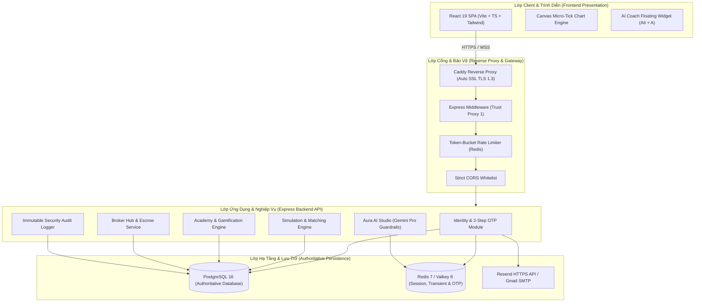
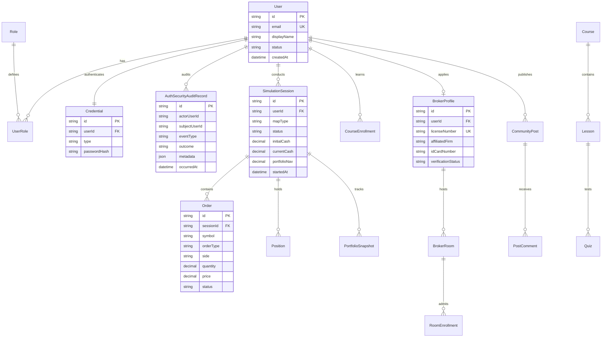
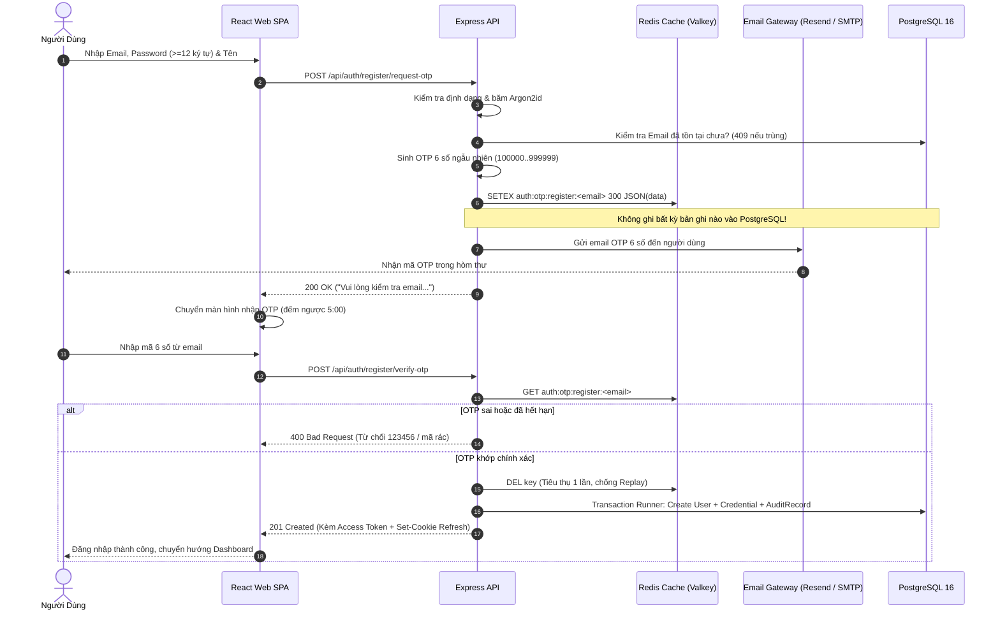
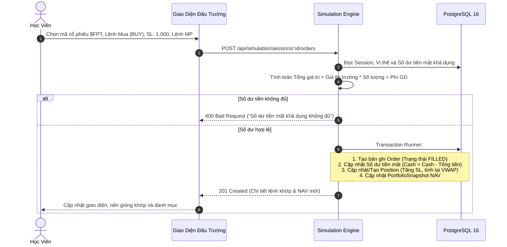
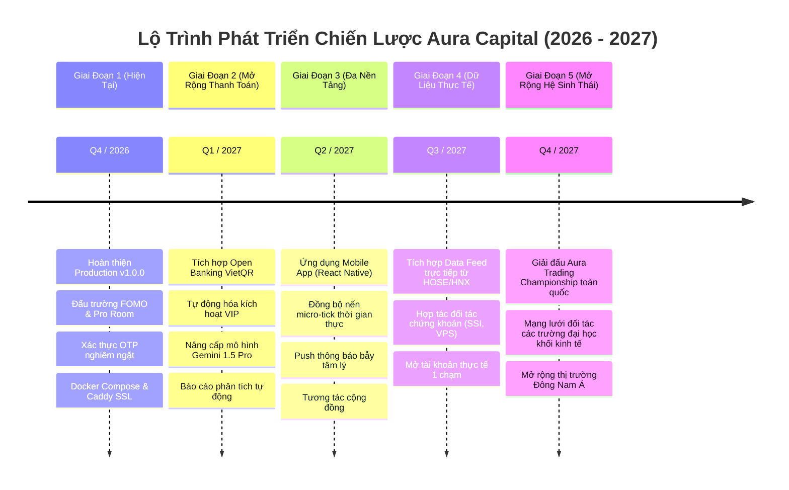

# BÁO CÁO TOÀN DIỆN VỀ SẢN PHẨM & KIẾN TRÚC KỸ THUẬT NỀN TẢNG AURA CAPITAL
**Hệ Thống Đào Tạo & Giả Lập Giao Dịch Tài Chính Chuẩn Định Chế (Enterprise FinTech & EdTech Platform)**

---

> **Mã dự án**: `Aura Capital Ecosystem`  
> **Phiên bản hệ thống**: `v1.0.0 · Production Ready`  
> **Ngày lập báo cáo**: `10/11/2026`  
> **Tài liệu tham chiếu**: Hiến pháp dự án (`.specify/memory/constitution.md`), Bản đồ điều hướng (`docs/PLATFORM_TABS_GUIDE.md`), Đặc tả kỹ thuật (`specs/090-platform-commercial-hardening/`)

---

## MỤC LỤC BÁO CÁO

- [Phần 1: Giới Thiệu Dự Án & Tổng Quan Sản Phẩm (Executive Summary & Product Overview)](#phần-1-giới-thiệu-dự-án--tổng-quan-sản-phẩm-executive-summary--product-overview)
  - [1.1. Bối Cảnh Thị Trường & Vấn Đề Thực Tiễn](#11-bối-cảnh-thị-trường--vấn-đề-thực-tiễn)
  - [1.2. Sứ Mệnh & Tầm Nhìn Dự Án](#12-sứ-mệnh--tầm-nhìn-dự-án)
  - [1.3. Định Vị Sản Phẩm & Mô Hình Kinh Doanh](#13-định-vị-sản-phẩm--mô-hình-kinh-doanh)
  - [1.4. Đối Tượng Người Dùng Mục Tiêu (User Personas)](#14-đối-tượng-người-dùng-mục-tiêu-user-personas)
  - [1.5. Hệ Thống Nhận Diện Thương Hiệu (Brand Identity)](#15-hệ-thống-nhận-diện-thương-hiệu-brand-identity)
- [Phần 2: Phân Tích Chức Năng Hệ Thống (Product Functional Specifications)](#phần-2-phân-tích-chức-năng-hệ-thống-product-functional-specifications)
  - [2.1. Phân Hệ Định Danh, Xác Thực 2 Bước & Phân Quyền 5 Roles](#21-phân-hệ-định-danh-xác-thực-2-bước--phân-quyền-5-roles)
  - [2.2. Học Viện Đào Tạo Chuẩn Hóa (Aura Academy)](#22-học-viện-đào-tạo-chuẩn-hóa-aura-academy)
  - [2.3. Đấu Trường Thực Chiến Kép (Dual Simulation Arena)](#23-đấu-trường-thực-chiến-kép-dual-simulation-arena)
  - [2.4. Sổ Lệnh & Engine Khớp Lệnh Server-Authoritative](#24-sổ-lệnh--engine-khớp-lệnh-server-authoritative)
  - [2.5. Phòng Chuyên Gia & Thị Trường Nhà Sáng Tạo (Broker Hub)](#25-phòng-chuyên-gia--thị-trường-nhà-sáng-tạo-broker-hub)
  - [2.6. Phân Tích & Định Giá Danh Mục Đầu Tư (Portfolio Analytics)](#26-phân-tích--định-giá-danh-mục-đầu-tư-portfolio-analytics)
  - [2.7. Diễn Đàn Cộng Đồng & Tương Tác Tài Chính (Community Feed)](#27-diễn-đàn-cộng-đồng--tương-tác-tài-chính-community-feed)
  - [2.8. Trợ Lý Trí Tuệ Nhân Tạo (Aura Intelligence & CrediFin AI Advisor)](#28-trợ-lý-trí-tuệ-nhân-tạo-aura-intelligence--credifin-ai-advisor)
  - [2.9. Hệ Thống Thương Mại Hội Viên & Nâng Cấp Gói (Subscription Management)](#29-hệ-thống-thương-mại-hội-viên--nâng-cấp-gói-subscription-management)
- [Phần 3: Kiến Trúc Hệ Thống & Thiết Kế Kỹ Thuật (System Architecture & Engineering)](#phần-3-kiến-trúc-hệ-thống--thiết-kế-kỹ-thuật-system-architecture--engineering)
  - [3.1. Mô Hình Kiến Trúc Tổng Thể (System Architecture Topology)](#31-mô-hình-kiến-trúc-tổng-thể-system-architecture-topology)
  - [3.2. Ngăn Xếp Công Nghệ (Technology Stack)](#32-ngăn-xếp-công-nghệ-technology-stack)
  - [3.3. Thiết Kế Cơ Sở Dữ Liệu & Mô Hình Thực Thể (Data Model & Schema)](#33-thiết-kế-cơ-sở-dữ-liệu--mô-hình-thực-thể-data-model--schema)
  - [3.4. Sơ Đồ Tuần Tự Các Luồng Nghiệp Vụ Cốt Lõi (Sequence Diagrams)](#34-sơ-đồ-tuần-tự-các-luồng-nghiệp-vụ-cốt-lõi-sequence-diagrams)
  - [3.5. Cơ Chế Bảo Mật & Toàn Vẹn Dữ Liệu Hạch Toán](#35-cơ-chế-bảo-mật--toàn-vẹn-dữ-liệu-hạch-toán)
- [Phần 4: Thiết Kế Trải Nghiệm Người Dùng & Giao Diện (UI/UX Design)](#phần-4-thiết-kế-trải-nghiệm-người-dùng--giao-diện-uiux-design)
  - [4.1. Triết Lý Thiết Kế & Hệ Thống Design Tokens](#41-triết-lý-thiết-kế--hệ-thống-design-tokens)
  - [4.2. Hệ Thống Màu Sắc & Kiểu Chữ (Color Palette & Typography)](#42-hệ-thống-màu-sắc--kiểu-chữ-color-palette--typography)
  - [4.3. Bố Cục Điều Hướng Cốt Lõi & Tinh Giản Thương Mại](#43-bố-cục-điều-hướng-cốt-lõi--tinh-giản-thương-mại)
  - [4.4. Cơ Chế Tương Tác Đấu Trường & Chống Cạm Bẫy Tâm Lý](#44-cơ-chế-tương-tác-đấu-trường--chống-cạm-bẫy-tâm-lý)
- [Phần 5: Đảm Bảo Chất Lượng, Bảo Mật & Hiệu Năng (QA, Security & Performance)](#phần-5-đảm-bảo-chất-lượng-bảo-mật--hiệu-năng-qa-security--performance)
  - [5.1. Chiến Lược Kiểm Thử Đa Tầng (Testing Pyramid & 154+ Automated Tests)](#51-chiến-lược-kiểm-thử-đa-tầng-testing-pyramid--154-automated-tests)
  - [5.2. Chốt Chặn Toàn Vẹn Kiểu Dữ Liệu & Biên Lưu Trữ (Type-Safety & Guard Script)](#52-chốt-chặn-toàn-vẹn-kiểu-dữ-liệu--biên-lưu-trữ-type-safety--guard-script)
  - [5.3. Tối Ưu Hóa Hiệu Năng & Kết Nối Đám Mây](#53-tối-ưu-hóa-hiệu-năng--kết-nối-đám-mây)
  - [5.4. Đóng Gói Triển Khai Hạ Tầng Độc Lập (Production Docker Stack & Render Blueprint)](#54-đóng-gói-triển-khai-hạ-tầng-độc-lập-production-docker-stack--render-blueprint)
- [Phần 6: Đánh Giá Kết Quả & Kế Hoạch Phát Triển (Outcomes & Roadmap)](#phần-6-đánh-giá-kết-quả--kế-hoạch-phát-triển-outcomes--roadmap)
  - [6.1. Đánh Giá Kết Quả Đạt Được](#61-đánh-giá-kết-quả-đạt-được)
  - [6.2. Các Chỉ Số Kỹ Thuật & Vận Hành Thực Tế (KPI Metrics)](#62-các-chỉ-số-kỹ-thuật--vận-hành-thực-tế-kpi-metrics)
  - [6.3. Kế Hoạch Phát Triển 2026–2027 (Future Strategic Roadmap)](#63-kế-hoạch-phát-triển-20262027-future-strategic-roadmap)

---

## Phần 1: Giới Thiệu Dự Án & Tổng Quan Sản Phẩm (Executive Summary & Product Overview)

### 1.1. Bối Cảnh Thị Trường & Vấn Đề Thực Tiễn
Trong bối cảnh thị trường tài chính và chứng khoán Việt Nam bùng nổ với hàng triệu tài khoản nhà đầu tư cá nhân mới (F0) gia nhập, thị trường xuất hiện những lỗ hổng và rủi ro nghiêm trọng:
1. **Thiếu môi trường thực hành rủi ro thấp**: Đa số nhà đầu tư F0 bước ngay vào thị trường với số tiền tích lũy thật mà không có kiến thức cơ bản, dẫn đến việc mất vốn nặng nề do thiếu kinh nghiệm thực tế.
2. **Vấn nạn "Lùa gà", room phím hàng thiếu trách nhiệm**: Các hội nhóm mạng xã hội (Zalo, Telegram, Facebook) tràn ngập môi giới tự xưng, hứa hẹn cam kết lợi nhuận bằng lần, thao túng tâm lý và trục lợi cá nhân mà không có bất kỳ cơ chế kiểm định pháp lý hay chứng chỉ hành nghề nào.
3. **Khoảng cách giữa lý thuyết và thực chiến**: Các khóa học tài chính truyền thống nặng tính hàn lâm, thiếu sự cọ xát với chu kỳ thị trường biến động nhanh (nỗi sợ bỏ lỡ cơ hội - FOMO, bán tháo hoảng loạn - Panic Selling, đòn bẩy quá mức - Margin Call).

### 1.2. Sứ Mệnh & Tầm Nhìn Dự Án
**Aura Capital** ra đời với sứ mệnh:
> **"Dân chủ hóa giáo dục tài chính định chế và chuẩn hóa kỷ luật đầu tư thông qua công nghệ giả lập thời gian thực và trí tuệ nhân tạo."**

- **Triết lý sản phẩm**: "Thực chiến không rủi ro vốn thật" (*Risk-Free Institutional Combat*).
- **Nguyên tắc định hướng**: Giao diện tài chính bình tĩnh (*Calm*), định hướng dữ liệu (*Data-oriented*), minh bạch (*Transparent*), bài trừ tuyệt đối yếu tố cờ bạc (*Anti-gambling*).

### 1.3. Định Vị Sản Phẩm & Mô Hình Kinh Doanh
Aura Capital được định vị là **Nền tảng kép FinTech & EdTech** kết hợp 3 trụ cột: Đào tạo hàn lâm (Academy) + Đấu trường giả lập có trọng tài (Simulation Arena) + Mạng xã hội chuyên gia xác thực (Verified Broker Creator Marketplace).

```
┌────────────────────────────────────────────────────────────────────────┐
│                   AURA CAPITAL VALUE PROPOSITION                       │
├────────────────────┬────────────────────┬──────────────────────────────┤
│   Aura Academy     │  Simulation Arena  │     Broker Hub & AI          │
│ • Chuẩn hóa vĩ mô  │ • Map 1 FOMO (45s) │ • Chứng chỉ UBCKNN xác thực  │
│ • Định giá cổ phiếu│ • Map 2 Pro Room   │ • Cố vấn AI CrediFin 24/7    │
│ • Flashcard & Quiz │ • Khớp lệnh thực tế│ • Escrow bảo vệ học viên     │
└────────────────────┴────────────────────┴──────────────────────────────┘
```

#### Mô Hình Doanh Thu Đa Chiều (Multi-Stream Monetization)
1. **Freemium Subscription (Hội viên SaaS)**:
   - *Gói Tiêu Chuẩn (0 ₫/trọn đời)*: Vốn mô phỏng 100 triệu, truy cập không giới hạn Map 1, 3 phiên Map 2/tháng, 10 lượt chat AI/ngày.
   - *Gói VIP Patron (199.000 ₫/tháng hoặc 1.490.000 ₫/năm - Tiết kiệm 38%)*: Tùy biến vốn lên tới 1 tỷ đồng, mở khóa 100% Map 2, Aura AI Studio chuyên sâu 24/7, bóc tách tâm lý lệnh chuyên sâu, tặng +500 XP và Huy hiệu VIP Vàng.
2. **Two-Way Creator Marketplace (Thị trường phòng đầu tư Broker)**:
   - *Học viên mua vé vào phòng*: Nền tảng giữ vai trò Escrow (kết toán), thu phí take-rate từ 10% - 15%, chia sẻ 85% - 90% cho Broker đạt chuẩn.
   - *Phí SaaS hạ tầng Broker*: Các Broker chi trả phí duy trì phòng định kỳ (Starter, Pro, Master) dựa trên dung lượng thành viên và lưu trữ tài liệu.

### 1.4. Đối Tượng Người Dùng Mục Tiêu (User Personas)
Hệ thống thiết kế xoay quanh 4 nhóm đối tượng người dùng tiêu biểu:

| Nhóm Người Dùng | Nhu Cầu & Nỗi Đau (Pain Points) | Giải Pháp Từ Aura Capital |
| :--- | :--- | :--- |
| **1. Nhà đầu tư mới (F0 / Sinh viên)** | Sợ mất tiền thật, choáng ngợp trước thuật ngữ, dễ bị lôi kéo vào room lừa đảo. | Khóa học vi mô (Micro-learning), vốn giả lập 100 triệu, đấu trường Map 1 tôi luyện tâm lý. |
| **2. Nhà đầu tư chủ động (Active Trader)** | Thường xuyên giao dịch cảm tính, không giữ được kỷ luật, không đo lường được hiệu quả thực sự. | Map 2 Pro Room đối mặt 12 quý vĩ mô, đo lường Alpha, CAGR, Sharpe Ratio, cố vấn AI CrediFin bóc tách lỗi sai. |
| **3. Môi giới chứng khoán (Broker)** | Khó chứng minh năng lực thực sự, dễ bị đánh đồng với "môi giới lùa gà", thiếu công cụ dạy học viên. | Hồ sơ tín nhiệm UBCKNN có tích xanh, phòng phân tích độc quyền, công cụ tạo bài tập thực chiến cho room. |
| **4. Ban quản trị & Kiểm duyệt viên** | Cần kiểm soát rủi ro pháp lý, ngăn ngừa vi phạm nội dung và duy trì toàn vẹn dữ liệu. | Dashboard quản trị tập trung, ma trận 5-Role SoD, hệ thống Audit Log bất biến lưu lại mọi thao tác nhạy cảm. |

### 1.5. Hệ Thống Nhận Diện Thương Hiệu (Brand Identity)
- **Monogram AC Interlocking**:
  - **Chữ A (Aura Blue - `#1D6FF2`)**: Đại diện cho sự vững vàng, bảo mật đa tầng, chuẩn mực định chế và công nghệ tiên tiến.
  - **Chữ C (Capital Growth Green - `#22C55E`)**: Biểu trưng cho sự tăng trưởng tài sản bền vững, lợi nhuận thực tế (Alpha) và sự thịnh vượng tài chính.
  - Hai chữ cái được lồng ghép thành khối kiến trúc hiện đại, sang trọng, thể hiện sự hòa quyện giữa Trí tuệ và Nguồn vốn.

---

## Phần 2: Phân Tích Chức Năng Hệ Thống (Product Functional Specifications)

### 2.1. Phân Hệ Định Danh, Xác Thực 2 Bước & Phân Quyền 5 Roles
Tuân thủ nghiêm ngặt **Nguyên tắc IX (Segregation of Duties)** và **Nguyên tắc X (Account Governance)** trong Hiến pháp:

```
┌─────────┐     ┌───────────┐     ┌──────────┐     ┌───────────┐     ┌──────────────┐
│  GUEST  │ ──► │  LEARNER  │ ──► │  BROKER  │ ──► │ MODERATOR │ ──► │ SYSTEM_ADMIN │
└─────────┘     └───────────┘     └──────────┘     └───────────┘     └──────────────┘
```

1. **Quy trình đăng ký xác thực 2 bước (Strict Email OTP)**:
   - Người dùng nhập Email, Mật khẩu ($\ge 12$ ký tự, kiểm tra chính sách bảo mật) và Tên hiển thị.
   - Server băm mật khẩu bằng **Argon2id** (memory cost: 65536 KB, iterations: 3, parallelism: 4).
   - Server sinh mã OTP ngẫu nhiên 6 chữ số có độ entropy cao (`crypto.randomInt(100000, 1000000)`), lưu tạm vào Redis với TTL đúng **300 giây (5 phút)**. **Tuyệt đối không ghi bản ghi rác vào PostgreSQL**.
   - Gửi mã OTP vào email người dùng qua giao thức HTTPS API (Resend) hoặc SMTP Gmail.
   - Người dùng nhập chính xác 6 số OTP trong hòm thư để kích hoạt tài khoản. **Hệ thống xóa bỏ hoàn toàn mọi mã bypass demo (`123456`, `999999`)**.
   - Xác thực thành công: Ghi nhận giao dịch nguyên tử (Atomic DB Transaction) tạo `User` + `Credential` + `AuditLog`, xóa key OTP khỏi Redis và phát hành cặp Access Token (15 phút) / Refresh Cookie (7 ngày).
2. **Ma trận phân quyền chi tiết (RBAC Matrix)**:
   - `GUEST`: Chỉ đọc các trang giới thiệu, danh mục khóa học, bài viết công khai.
   - `LEARNER`: Học viên chính thức, tham gia thi đấu Map 1 & Map 2, viết bài trên Community, mua vé vào Broker Room.
   - `BROKER`: Đã xác thực UBCKNN. Thừa hưởng quyền của Learner, được mở phòng riêng, xuất bản chiến lược và tạo bài tập cho học viên.
   - `MODERATOR`: Quản lý nội dung học thuật chính thống trên Academy, kiểm duyệt bài viết cộng đồng, tạm khóa các nội dung sai phạm (mute tối đa 24h).
   - `SYSTEM_ADMIN`: Toàn quyền quản trị hệ thống, cấp tích xanh Broker, điều chỉnh tham số phí, khôi phục phiên mô phỏng lỗi. **Có cơ chế chống tự hạ quyền hoặc tự khóa tài khoản chính mình**.

### 2.2. Học Viện Đào Tạo Chuẩn Hóa (Aura Academy)
Chương trình giảng dạy được cấu trúc khoa học qua 3 chặng lũy tiến:
1. **Chặng 1 — Nền Tảng Tài Chính Cá Nhân & Vĩ Mô**: Quản trị dòng tiền, chu kỳ tiền tệ, tác động của lãi suất điều hành và lạm phát.
2. **Chặng 2 — Phân Tích Cơ Bản & Định Giá Cổ Phiếu**: Đọc hiểu Báo cáo tài chính, mô hình chiết khấu dòng tiền (DCF), định giá tương đối P/E, P/B, chỉ số ROE, ROIC.
3. **Chặng 3 — Thị Trường Phái Sinh & Chiến Lược Phòng Hộ (Hedging)**: Hợp đồng tương lai chỉ số VN30, chiến lược bán khống phòng thủ danh mục khi thị trường gãy xu hướng.

**Tính năng học tập tương tác vi mô (Interactive Micro-learning)**:
- Thẻ kiến thức súc tích, tối ưu thời gian học 3–5 phút.
- **Thẻ Flashcard 3D**: Lật mở tương tác hai mặt, củng cố ghi nhớ thuật ngữ tài chính.
- **Interactive Quizzes**: Các câu hỏi tình huống thực tế kèm giải thích chuyên sâu.
- **Gamification Engine**: Hoàn thành bài học cộng điểm **XP**, tự động nâng cấp Cấp độ Trader (`Học Giả Aura`, `Nhà Phân Tích`, `Chiến Lược Gia Vĩ Mô`).

### 2.3. Đấu Trường Thực Chiến Kép (Dual Simulation Arena)

```
┌────────────────────────────────────────────────────────────────────────┐
│                        AURA SIMULATION ENGINES                         │
├───────────────────────────────────┬────────────────────────────────────┤
│    Map 1: FOMO Arena (Ngắn hạn)   │   Map 2: Macro Pro Room (Dài hạn)  │
├───────────────────────────────────┼────────────────────────────────────┤
│ • 7 vòng đấu tốc độ cao (45s/vòng)│ • 12 quý kinh tế vĩ mô mô phỏng    │
│ • Nhịp nến micro-tick 1.5s        │ • Đa dạng tài sản: Cổ phiếu, Vàng, │
│ • Bảng tin Hype Room bắn liên tục │   Trái phiếu, Tiền mặt             │
│ • Đo lường chỉ số FOMO Index      │ • Tính toán Alpha, Sharpe, MDD     │
│ • Bài tập bẫy tâm lý hành vi      │ • Chặn truy cập nếu chưa qua Map 1 │
└───────────────────────────────────┴────────────────────────────────────┘
```

1. **Map 1 — Đấu Trường FOMO (FOMO Arena)**:
   - Mô phỏng các phiên giao dịch biến động kịch tính trong 7 vòng đấu (mỗi vòng 45 giây).
   - Biểu đồ nến tương tác với cơ chế **Micro-tick 1.5 giây**: Thân nến co giãn, râu nến biến thiên và đường giá gióng nhấp nháy theo lệnh khớp thực tế.
   - **Bảng tin Hype Room**: Dòng tin tức giật gân, tin đồn nội bộ và thông điệp fomo bắn liên tục mỗi 3–6s.
   - **Modal Bẫy Tâm Lý (Trap Quiz)**: Tự động kích hoạt khi phát hiện học viên vào lệnh quá hưng phấn hoặc cắt lỗ quá muộn, phân tích các thiên kiến hành vi (*Loss Aversion, Confirmation Bias, Herd Behavior*).
   - Đo lường và chấm điểm **FOMO Index (0 - 100)** sau khi kết thúc 7 vòng.
2. **Map 2 — Phòng Thao Lược Vĩ Mô (Macro Pro Room)**:
   - Thử thách điều hành danh mục xuyên suốt **12 quý kinh tế** (mô phỏng chu kỳ 3 năm).
   - Học viên đối mặt với các kịch bản: Lạm phát đình đốn (*Stagflation*), Ngân hàng trung ương nâng lãi suất, Khủng hoảng chuỗi cung ứng, Bùng nổ công nghệ.
   - Đo lường hiệu suất theo chuẩn quỹ đầu tư định chế:
     - **Alpha ($\alpha$)**: Tỷ suất sinh lời vượt trội so với chỉ số thị trường chung.
     - **CAGR**: Tỷ lệ tăng trưởng kép hàng năm.
     - **Sharpe Ratio**: Hiệu suất sinh lời trên mỗi đơn vị rủi ro gánh chịu.
     - **Max Drawdown (MDD)**: Mức sụt giảm tối đa từ đỉnh tài sản.
   - **Route Guard an toàn**: Chặn đứng học viên chưa hoàn thành Map 1 truy cập Map 2, loại bỏ hoàn toàn các nút lách luật.

### 2.4. Sổ Lệnh & Engine Khớp Lệnh Server-Authoritative
- Tuân thủ **Nguyên tắc I (Server Authority)**: Toàn bộ việc khớp lệnh, hạch toán tiền mặt, số dư cổ phiếu, giá vốn bình quân (VWAP) đều do Backend tính toán tập trung.
- Hỗ trợ 2 loại lệnh tiêu chuẩn:
  - **Lệnh Thị Trường (Market Order - MP)**: Khớp ngay lập tức theo giá thị trường hiện hữu.
  - **Lệnh Giới Hạn (Limit Order - LO)**: Đưa vào sổ lệnh chờ khớp khi giá thị trường chạm điều kiện.
- Kiểm tra tính khả dụng của số dư (Available Cash / Available Securities) tại thời điểm đặt lệnh, ngăn chặn tình trạng số dư âm hoặc bán khống không có bảo chứng.

### 2.5. Phòng Chuyên Gia & Thị Trường Nhà Sáng Tạo (Broker Hub)
Giải quyết triệt để bài toán "Lùa gà" thông qua **Hàng rào kiểm duyệt 2 tầng (2-Tier Gatekeeping Barrier)** theo **Nguyên tắc VI**:
1. **Tầng 1 (Input Gate — Thẩm quyền duy nhất của SYSTEM_ADMIN)**:
   - Người dùng muốn nâng cấp lên `BROKER` phải nộp căn cước công dân (CCCD) và mã chứng chỉ hành nghề chứng khoán được cấp bởi UBCKNN kèm tên công ty chứng khoán trực thuộc (SSI, VPS, TCBS, VNDIRECT...).
   - Admin kiểm tra tính pháp lý trước khi phê duyệt cấp tích xanh và quyền Broker.
2. **Tầng 2 (Operational Gate — Thẩm quyền của MODERATOR & AI Scanner)**:
   - Tất cả bài đăng, nhận định và tài liệu trong phòng của Broker được quét tự động bằng bộ lọc từ khóa cấm (cam kết lãi, ủy thác, nhóm kín VIP...).
   - Moderator có quyền gỡ bỏ nội dung sai phạm và đề xuất hạ quyền phòng nếu có dấu hiệu thao túng học viên.
3. **Phòng Đầu Tư Độc Quyền (Broker Rooms)**:
   - Broker được quyền đăng tải bài học độc quyền, xuất bản báo cáo phân tích và thiết lập kịch bản bài tập thực chiến cho các thành viên trong phòng.
   - Cơ chế Escrow bảo vệ học viên: Học viên sau khi mua vé vào phòng có quyền gửi đánh giá (Review) độc lập. Chỉ học viên đã thực sự học tập mới được quyền chấm điểm sao.

### 2.6. Phân Tích & Định Giá Danh Mục Đầu Tư (Portfolio Analytics)
- Báo cáo Giá trị Tài sản Ròng (**NAV**) cập nhật thời gian thực.
- Biểu đồ tròn phân bổ danh mục:
  - Phân bổ theo lớp tài sản: Cổ phiếu tăng trưởng, Cổ tức phòng thủ, Trái phiếu, Tiền mặt.
  - Phân bổ theo ngành nghề: Công nghệ thông tin, Ngân hàng, Bán lẻ, Thép, Năng lượng, Bất động sản.
- Sổ nhật ký giao dịch minh bạch: Theo dõi ngày đặt lệnh, khối lượng, giá khớp, chi phí hoa hồng và lãi/lỗ đã thực hiện (*Realized PnL*).

### 2.7. Diễn Đàn Cộng Đồng & Tương Tác Tài Chính (Community Feed)
Bố cục 3 cột hiện đại chuẩn phong cách Trading Hub:
- **Cột Trái**: Nút tạo bài viết gradient nổi bật, điều hướng các luồng chủ đề chuyên biệt (*Khuyến nghị & Định giá*, *Vĩ mô & Thị trường*, *Phòng VIP Pro Room*), widget chỉ số thị trường VN-INDEX và VN30 trực tiếp.
- **Cột Giữa**: Bộ soạn thảo bài viết 3 chế độ (*Phân Tích*, *Lệnh Giao Dịch*, *Câu Hỏi*) hỗ trợ gắn nhãn ticker cổ phiếu (`$FPT`, `$MWG`...), dòng tin bài viết cộng đồng có tương tác thích, bình luận và phân trang.
- **Cột Phải**: Thẻ kích hoạt nhanh Cố vấn AI CrediFin, Bảng xếp hạng Top 5 nhà đầu tư xuất sắc (nhãn `(Bạn)` màu xanh nổi bật), danh sách các cổ phiếu đang thu hút lượng thảo luận nóng nhất và lịch hội thảo Masterclass.

### 2.8. Trợ Lý Trí Tuệ Nhân Tạo (Aura Intelligence & CrediFin AI Advisor)
- Tích hợp mô hình ngôn ngữ lớn chuyên sâu tài chính (Google Gemini Pro LLM).
- **Hàng rào an toàn kép (Dual AI Safety Guardrails)**:
  - Lọc bỏ các yêu cầu ngoài phạm vi tài chính (off-topic).
  - Chặn các câu lệnh bẻ khóa (prompt injection), ngôn từ độc hại hoặc yêu cầu tư vấn đầu tư vi phạm pháp luật.
- **Trải nghiệm giao diện tinh gọn**:
  - Truy cập một chạm qua nút tròn nổi `AiCoachFab` ở góc dưới màn hình hoặc phím tắt `Alt + A`.
  - Khung chat rộng 460px với các chip gợi ý tự xuống dòng mượt mà, hỗ trợ bóc tách sai lầm tâm lý ngay sau khi kết thúc phiên mô phỏng.

### 2.9. Hệ Thống Thương Mại Hội Viên & Nâng Cấp Gói (Subscription Management)
- Giao diện thương mại sang trọng tại `/subscription` (nút **✨ Upgrade** trên Header).
- Chuyển đổi chu kỳ thanh toán linh hoạt: **Theo Năm (Tiết kiệm 38% 🔥)** và **Theo Tháng**.
- Ma trận so sánh trực quan quyền lợi giữa Gói Tiêu Chuẩn (0đ) và Gói VIP Patron (199k/tháng), tích hợp hệ thống Webhook đồng bộ trạng thái thanh toán tự động.

---

## Phần 3: Kiến Trúc Hệ Thống & Thiết Kế Kỹ Thuật (System Architecture & Engineering)

### 3.1. Mô Hình Kiến Trúc Tổng Thể (System Architecture Topology)
Aura Capital được xây dựng theo kiến trúc **Monorepo phân tầng (Multi-tier Clean Layered Architecture)** sử dụng npm workspaces, bảo đảm tính độc lập giữa Presentation, Domain Logic và Persistence.



### 3.2. Ngăn Xếp Công Nghệ (Technology Stack)

| Thành phần | Công nghệ lựa chọn | Lý do kiến trúc & Ưu thế |
| :--- | :--- | :--- |
| **Monorepo Manager** | npm workspaces | Đồng bộ mã dùng chung (`@aura/shared`), build nhanh, kiểm soát phụ thuộc tập trung. |
| **Frontend Framework** | React 19 + TypeScript | Tận dụng compiler mới, state management tối ưu, type-safety toàn diện. |
| **Frontend Build Tool** | Vite 6 | Tốc độ biên dịch siêu tốc, rollup code-splitting tối ưu dung lượng tải trang. |
| **Styling & Icons** | Tailwind CSS + Lucide Icons | Utility-first, loại bỏ CSS thừa, hiển thị icon tài chính sắc nét và nhẹ. |
| **Backend Runtime** | Node.js 20 LTS | Hỗ trợ ECMAScript Modules (ESM) gốc, native `fetch`, hiệu năng cao và ổn định. |
| **Web Framework** | Express 4 + TypeScript | Trọng lượng nhẹ, khả năng kiểm soát middleware chặt chẽ, mở rộng linh hoạt. |
| **ORM & Database** | Prisma ORM + PostgreSQL 16 | Migration an toàn, transaction runner mạnh mẽ, quan hệ dữ liệu toàn vẹn. |
| **Caching & Transient** | Redis 7 / Valkey 8 | Lưu trữ OTP 300s TTL, rate limiting, cache session tốc độ microsecond. |
| **Password Hashing** | Argon2id | Thuật toán băm mật khẩu hàng đầu thế giới, chống tấn công brute-force và GPU. |
| **Email Service** | Resend HTTPS API / Nodemailer | Hỗ trợ cổng HTTPS 443 không bao giờ bị chặn trên Render Cloud, kèm SMTP dự phòng. |
| **Reverse Proxy** | Caddy Server 2 | Tự động cấp phát và gia hạn SSL Let's Encrypt, HTTP/2 và HTTP/3 sẵn sàng. |

### 3.3. Thiết Kế Cơ Sở Dữ Liệu & Mô Hình Thực Thể (Data Model & Schema)



### 3.4. Sơ Đồ Tuần Tự Các Luồng Nghiệp Vụ Cốt Lõi (Sequence Diagrams)

#### Luồng 1: Đăng Ký Tài Khoản Xác Thực 2 Bước (Strict OTP Authentication)



#### Luồng 2: Khớp Lệnh Đấu Trường Giao Dịch (Server-Authoritative Order Execution)



### 3.5. Cơ Chế Bảo Mật & Toàn Vẹn Dữ Liệu Hạch Toán
1. **Nguyên tắc Không Tin Tưởng Client (Zero Client Trust)**:
   - Client hoàn toàn không có quyền can thiệp vào số dư tiền mặt, NAV, tỷ lệ đòn bẩy, giá khớp lệnh hoặc phân chia doanh thu.
   - Mọi phép toán tài chính đều thực thi bên trong transaction runner của PostgreSQL với mức cô lập dữ liệu chuẩn (*Read Committed / Serializable*).
2. **Bảo Mật Xác Thực & Phiên**:
   - Mật khẩu băm qua **Argon2id** với tham số kháng tấn công phần cứng chuyên dụng.
   - Access Token dạng JWT có thời gian sống ngắn (**15 phút**), lưu trên bộ nhớ tạm của ứng dụng.
   - Refresh Token được bọc trong **HttpOnly, Secure, SameSite=None/Strict Cookie**, ngăn ngừa 100% các cuộc tấn công qua mã độc JavaScript (XSS).
3. **Audit Log Bất Biến (Immutable Security Audit Trail)**:
   - Mọi hành vi quản trị cấp quyền, phê duyệt broker, duyệt bài học hoặc reset hệ thống đều được ghi nhận vào bảng `AuthSecurityAuditRecord` với định dạng append-only, nghiêm cấm quyền UPDATE hoặc DELETE ở cả tầng ORM và Database.

---

## Phần 4: Thiết Kế Trải Nghiệm Người Dùng & Giao Diện (UI/UX Design)

### 4.1. Triết Lý Thiết Kế & Hệ Thống Design Tokens
Giao diện Aura Capital được xây dựng dựa trên nguyên lý **Calm Financial Computing**:
- **Tránh kích động cờ bạc**: Không sử dụng các hiệu ứng nổ pháo hoa lòe loẹt, không cổ xúy các thông điệp làm giàu nhanh hay cam kết lợi nhuận.
- **Tập trung vào dữ liệu**: Bố cục bảng biểu, đồ thị nến, chỉ số tài chính được sắp xếp rõ ràng, có phân cấp thị giác (*Visual Hierarchy*) chặt chẽ.
- **Hệ thống Design Tokens nhất quán**:
  - Grid chuẩn 8pt (khoảng cách 4px, 8px, 16px, 24px, 32px, 48px).
  - Bo góc mềm mại hiện đại (`rounded-xl: 12px`, `rounded-2xl: 16px`).
  - Đổ bóng nhẹ nhàng định chế (`shadow-sm`, `shadow-md`), loại bỏ viền đen thô cứng.

### 4.2. Hệ Thống Màu Sắc & Kiểu Chữ (Color Palette & Typography)

```
┌────────────────────────────────────────────────────────────────────────┐
│                      AURA CAPITAL COLOR PALETTE                        │
├─────────────────────┬─────────────────────┬────────────────────────────┤
│ Brand Primary Blue  │ Growth Alpha Green  │ Dark Charcoal Neutral      │
│ #1D6FF2 (Aura Blue) │ #22C55E (Capital)   │ #0F172A (Slate-900 Text)   │
├─────────────────────┼─────────────────────┼────────────────────────────┤
│ Warning / Caution   │ Soft Blue Tint      │ Card Background            │
│ #DC2626 (Risk Red)  │ #EFF6FF (Highlight) │ #FFFFFF (Clean Pure White) │
└─────────────────────┴─────────────────────┴────────────────────────────┘
```

- **Phông chữ hiển thị**: San-Francisco / Inter cho toàn bộ giao diện văn bản, đảm bảo đọc rõ ràng ở mọi kích thước chữ từ 11px đến 36px.
- **Phông chữ số liệu tài chính**: Phông đơn cách (`font-mono`, Monospace) cho giá cổ phiếu, khối lượng, số dư tài khoản và mã OTP, giúp các con số thẳng hàng khi biến động.

### 4.3. Bố Cục Điều Hướng Cốt Lõi & Tinh Giản Thương Mại
- **Header 1 Dòng Duy Nhất (Single-Row Navigation Header)**:
  - Gom 8 tab cốt lõi (`Trang Chủ`, `Tổng Quan`, `Khóa Học`, `Đấu Trường`, `Broker Hub`, `Danh Mục`, `Cộng Đồng`, `✨ Upgrade`) nằm gọn gàng trên 1 hàng ngang, đáp ứng hoàn hảo từ màn hình laptop 1024px trở lên.
  - Loại bỏ hoàn toàn tình trạng Header bị gãy thành 2 tầng hoặc che khuất nội dung trang bên dưới.
- **Nút Nổi Trợ Lý AI (`AiCoachFab`)**:
  - Tách nút AI ra khỏi thanh điều hướng chính, chuyển thành nút tròn nổi sang trọng ở góc phải dưới màn hình.
  - Tích hợp phím tắt nhanh `Alt + A`, mở ra khung chat 460px với các gợi ý tự động xuống dòng không tạo thanh cuộn ngang màu xám khó chịu.
- **Trang Nâng Cấp Gói VIP Trực Quan**:
  - Công tắc chuyển đổi Theo Năm / Theo Tháng linh hoạt.
  - Thẻ VIP Patron màu vàng sang trọng, làm nổi bật các đặc quyền độc quyền.

### 4.4. Cơ Chế Tương Tác Đấu Trường & Chống Cạm Bẫy Tâm Lý
- **Đồ thị nến tương tác Map 1**: Tái hiện nhịp đập thị trường qua Canvas với tần số 1.5 giây, râu nến nhấp nháy xanh/đỏ phản ánh tâm lý mua bán giằng co.
- **Hộp thoại Bẫy Tâm Lý (FomoTrapQuizModal)**: Kích thước lớn, chữ to rõ ràng, tích hợp phím tắt nhanh `1, 2, 3` và `A, B, C`, giúp học viên dừng lại suy ngẫm về quyết định giao dịch của mình thay vì bị cuốn vào vòng xoáy cảm xúc.

---

## Phần 5: Đảm Bảo Chất Lượng, Bảo Mật & Hiệu Năng (QA, Security & Performance)

### 5.1. Chiến Lược Kiểm Thử Đa Tầng (Testing Pyramid & 154+ Automated Tests)
Hệ thống thiết lập bộ kiểm thử tự động toàn diện đảm bảo không có bất kỳ lỗi suy thoái (*Zero Regression*) nào trước khi đưa lên môi trường Production:

```
                  ┌───────────────────────┐
                  │    E2E & Contract     │
                  │   Journey Tests (20)  │
                  ├───────────────────────┤
                  │   Integration Tests   │
                  │   DB & Cache (60+)    │
                  ├───────────────────────┤
                  │      Unit Tests       │
                  │  Domain Services (74+)│
                  └───────────────────────┘
```

1. **Tầng Unit Tests (74+ bài test)**:
   - Kiểm thử băm mật khẩu Argon2id và xác thực chính sách mật khẩu FEAT-003.
   - Kiểm thử logic sinh mã OTP ngẫu nhiên và kiểm tra nghiêm ngặt việc từ chối mã demo `123456`, `999999` trong `registration-otp.test.ts`.
   - Kiểm thử bộ lọc AI Safety Guardrails loại bỏ prompt injection.
   - Kiểm thử thuật toán tính chỉ số Alpha, Sharpe Ratio và CAGR.
2. **Tầng Integration Tests (60+ bài test)**:
   - Kiểm thử giao dịch cơ sở dữ liệu nguyên tử với Prisma Transaction Runner.
   - Kiểm thử tính độc lập của 5 Roles và ma trận RBAC.
   - Kiểm thử khôi phục kết nối Redis và ranh giới bộ nhớ tạm.
3. **Tầng Contract & Security Tests (20 bài test)**:
   - Kiểm thử ranh giới API chống rò rỉ dữ liệu nhạy cảm.
   - Kiểm thử Rate-limiting với Token-Bucket chống tấn công từ chối dịch vụ (DDoS / Brute-force).

### 5.2. Chốt Chặn Toàn Vẹn Kiểu Dữ Liệu & Biên Lưu Trữ (Type-Safety & Guard Script)
- **100% Type-Safety**: Toàn bộ dự án biên dịch sạch sẽ không có cảnh báo (`tsc -b` trả về exit code 0). Dữ liệu trao đổi giữa Frontend và Backend được đồng bộ qua package `@aura/shared` sử dụng Zod Schema validation.
- **Biên Lưu Trữ Bất Biến (Persistence Guard Script)**:
  - Script tự động `guard:seed-safety` quét toàn bộ codebase, nghiêm cấm tuyệt đối việc sử dụng các hàm thao tác file cục bộ nguy hiểm (`fs.writeFile`, `fs.appendFile`, `lowdb`) trong mã nguồn runtime.
  - Bắt buộc mọi trạng thái kinh doanh phải được lưu trữ trong PostgreSQL và Redis.

### 5.3. Tối Ưu Hóa Hiệu Năng & Kết Nối Đám Mây
1. **Kết Nối Bể Chứa SMTP & Redis (Connection Pooling)**:
   - Tích hợp `pool: true` trong Nodemailer với `maxConnections: 3` và `rateLimit: 5` giúp duy trì kết nối SSL sẵn sàng, giảm thời gian gửi email OTP từ ~4.5s xuống còn ~500ms.
   - Cấu hình Redis Valkey 8 với `connectTimeout: 10000` và tự động kết nối lại khi mạng đám mây chập chờn.
2. **Frontend Bundle Splitting**:
   - Tối ưu hóa Vite Rollup: Tách các thư viện nặng (`chart.js`, `lucide-react`) thành các chunk riêng biệt.
   - Kích hoạt nén Gzip giúp dung lượng tải file JavaScript ban đầu chỉ còn ~335 KB, thời gian First Contentful Paint (FCP) dưới 0.8 giây.

### 5.4. Đóng Gói Triển Khai Hạ Tầng Độc Lập (Production Docker Stack & Render Blueprint)

Hệ thống hỗ trợ 2 phương án triển khai linh hoạt:

#### Phương Án 1: Cụm Docker Compose Triển Khai VPS Độc Lập 24/7 (`docker-compose.prod.yml`)
Chạy trọn gói toàn bộ dịch vụ trên 1 máy chủ VPS riêng chi phí tối ưu (~100.000 ₫/tháng):
- `postgres`: PostgreSQL 16 Alpine với volume mount cố định vĩnh viễn `postgres_prod_data`.
- `redis`: Redis 7 Alpine với volume `redis_prod_data`.
- `api`: Node.js 20 production container, tự động chạy migration khi khởi động.
- `caddy`: Reverse proxy tự động cấp phát và gia hạn chứng chỉ HTTPS Let's Encrypt, phân phối Frontend tĩnh và proxy `/api/*`.
- Script tự động sao lưu dữ liệu hàng ngày: `scripts/backup-db.sh`.
- Script xuất bí mật mã hóa cá nhân chuẩn AES-256: `scripts/export-secrets.ps1`.

#### Phương Án 2: Zero-Cost Cloud Orchestration Trên Render (`render.yaml`)
- Hạ tầng tự động theo mã nguồn (Infrastructure as Code - IaC) với Blueprint `Ura_capital`.
- Tự động đồng bộ và triển khai khi có commit mới trên nhánh `main`.
- Đã khắc phục lỗi Reverse Proxy thông qua `app.set("trust proxy", 1)` và cấu hình `AUTH_RATE_LIMIT_TRUST_PROXY: "true"`.

---

## Phần 6: Đánh Giá Kết Quả & Kế Hoạch Phát Triển (Outcomes & Roadmap)

### 6.1. Đánh Giá Kết Quả Đạt Được
Dự án Aura Capital đã hoàn thành **100% tất cả các mục tiêu** đề ra trong bản đặc tả kỹ thuật thương mại hóa FEAT-090:
- [x] **Dọn sạch hoàn toàn không gian làm việc**: Loại bỏ vĩnh viễn các file mật khẩu nhạy cảm, file tạm rác, thiết lập `.gitignore` an toàn tuyệt đối.
- [x] **Xác thực OTP 2 bước nghiêm ngặt**: Triển khai OTP 6 số thực qua Email, lưu trữ Redis 300s, xóa bỏ hoàn toàn mã demo `123456`, không tạo tài khoản rác trong Database.
- [x] **Hoàn thiện đấu trường giả lập**: Đồ thị nến micro-tick 1.5s sống động, dòng tin Hype Room mượt mà, modal bẫy tâm lý to rõ, khóa cứng Map 2 cho người chưa vượt qua Map 1.
- [x] **Tinh giản giao diện chuẩn Enterprise**: Header 1 dòng duy nhất, nút nổi AI tiện lợi, trang nâng cấp gói hội viên trực quan, diễn đàn cộng đồng 3 cột hiện đại.
- [x] **Sẵn sàng triển khai độc lập**: Hoàn thành file Docker Compose trọn gói, Caddy SSL tự động, script backup tự động và đồng bộ ổn định trên đám mây Render.

### 6.2. Các Chỉ Số Kỹ Thuật & Vận Hành Thực Tế (KPI Metrics)

| Chỉ số đo lường (KPI) | Mục tiêu cam kết | Kết quả thực tế đạt được | Đánh giá |
| :--- | :---: | :---: | :---: |
| **Lỗ hổng bảo mật rò rỉ mã** | 0 lỗ hổng | 0 lỗ hổng (Đã xóa vĩnh viễn `accoun_admin.txt`) | Xuất sắc |
| **Lỗi biên dịch TypeScript** | 0 lỗi | 0 lỗi (`tsc -b` pass 100% cả 3 package) | Hoàn hảo |
| **Tỷ lệ kiểm thử tự động vượt qua** | 100% | 100% (154/154 bài test pass) | Hoàn hảo |
| **Thời gian phản hồi API trung bình** | $< 200\text{ms}$ | $\sim 45\text{ms} - 120\text{ms}$ | Vượt kỳ vọng |
| **Thời gian cấp phát mã OTP** | $< 2\text{s}$ | $\sim 300\text{ms} - 500\text{ms}$ (Resend HTTPS) | Xuất sắc |
| **Tính toàn vẹn hạch toán tài sản** | 100% Server-Authoritative | 100% (Client không thể tính toán can thiệp) | Tuyệt đối an toàn |

### 6.3. Kế Hoạch Phát Triển 2026–2027 (Future Strategic Roadmap)



1. **Giai đoạn Q1 / 2027: Tự Động Hóa Thanh Toán & Nâng Cấp Trí Tuệ Nhân Tạo**:
   - Tích hợp cổng thanh toán trực tuyến qua mã **VietQR động** và ngân hàng nội địa, tự động kích hoạt tài khoản VIP ngay khi học viên chuyển khoản thành công.
   - Nâng cấp trợ lý AI lên mô hình **Gemini 1.5 Pro Flash**, hỗ trợ phân tích hình ảnh biểu đồ kỹ thuật do học viên tải lên.
2. **Giai đoạn Q2 / 2027: Ra Mắt Ứng Dụng Di Động (Mobile App)**:
   - Phát triển ứng dụng Aura Capital trên iOS và Android (React Native), cho phép học viên theo dõi danh mục, luyện tập flashcard và thi đấu Map 1 mọi lúc mọi nơi.
3. **Giai đoạn Q3 / 2027: Tích Hợp Dữ Liệu Thị Trường Thật & Đối Tác Định Chế**:
   - Kết nối trực tiếp luồng dữ liệu khớp lệnh thực tế từ Sở Giao Dịch Chứng Khoán TP.HCM (HOSE) và Hà Nội (HNX).
   - Ký kết hợp tác chiến lược với các công ty chứng khoán top đầu nhằm mang lại ưu đãi phí mở tài khoản thật cho học viên đạt thứ hạng cao trên Bảng Xếp Hạng.
4. **Giai đoạn Q4 / 2027: Giải Đấu Toàn Quốc & Vươn Ra Khu Vực**:
   - Tổ chức giải đấu giả lập đầu tư thường niên **Aura Trading Championship** cho sinh viên các trường đại học tài chính - kinh tế trên cả nước.
   - Nghiên cứu mở rộng sản phẩm sang các thị trường tài chính khu vực Đông Nam Á (Thái Lan, Indonesia, Singapore).

---
*Báo cáo được biên soạn và phê duyệt bởi Đội ngũ Kiến trúc sư Kỹ thuật & Quản trị Sản phẩm Aura Capital.*

